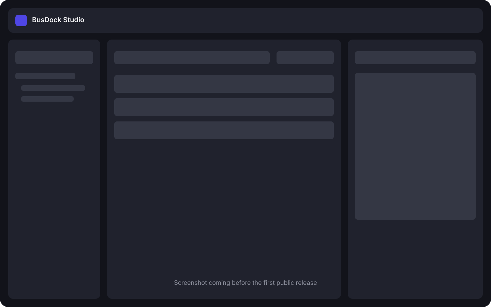

# BusDock Studio

**Inspect, manage, and recover your messages.**

BusDock Studio is an open-source desktop explorer for Azure Service Bus, designed first for macOS. It provides a modern, cautious workflow for browsing namespaces and diagnosing queue or subscription messages without pretending that peeked messages can be individually deleted.

> BusDock Studio is an independent open-source community project. It is not developed, sponsored, endorsed, or supported by Microsoft. Azure and Microsoft are trademarks of their respective owners; no Microsoft or Azure logos are used by this project.

## Features

- Add and test a namespace connection string; the credential is kept in memory only.
- Browse queues, topics, and subscriptions in a three-panel Avalonia UI.
- Peek active, dead-letter, and transfer dead-letter subqueues without locking messages.
- Inspect formatted JSON, text, Base64, system properties, application properties, and dead-letter details.
- Search, refresh, page by sequence number, and choose a page size up to the service limit.
- Purge eligible messages with a fixed UTC cutoff, exact-name confirmation, partition checks, progress, cancellation, and explicit partial-completion warnings.
- Follow the system, light, or dark appearance.

## Screenshot



The placeholder will be replaced with a real application screenshot before the first public release.

## Requirements

- macOS on Apple Silicon for the initial packaged target.
- [.NET 10 SDK](https://dotnet.microsoft.com/download/dotnet/10.0) to build from source.
- An Azure Service Bus namespace connection string. See permissions below.

## Run from source

```bash
dotnet restore BusDockStudio.sln
dotnet build BusDockStudio.sln --no-restore
dotnet test BusDockStudio.sln --no-build
dotnet run --project src/BusDockStudio.Desktop
```

The solution uses stable releases only: Avalonia 12.1.4, CommunityToolkit.Mvvm 8.4.2, Azure.Messaging.ServiceBus 7.21.0, and Azure.Identity 1.21.0.

## Install a local macOS build

Create an Apple Silicon, self-contained application bundle:

```bash
./scripts/package-macos.sh
open artifacts/BusDockStudio.app
```

The local bundle is unsigned. macOS may require a Control-click → Open on first launch. Signing, notarization, and DMG steps are documented in [macOS packaging](docs/macos-packaging.md).

## Azure authorization requirements

Entity discovery uses the administration client and normally requires a namespace-level connection string with **Manage** permission. Peeking and broker-side purge require data-plane **Listen** rights; exact requirements can vary by the namespace policy. Prefer a narrowly scoped, non-production namespace while evaluating the app.

Connection strings are accepted for the MVP. Interactive browser authentication with `Azure.Identity` is part of the roadmap.

## Security warnings

Purge is permanent. Before a purge, BusDock Studio shows the namespace, entity, subqueue, and approximate count, then requires the exact entity name. One UTC cutoff is captured so messages enqueued after the operation starts are not targeted. Partitioned entities are rejected. Locked, deferred, and scheduled messages can remain. Timeout, cancellation, or connectivity loss can mean a partially completed purge.

Never paste credentials into issues, screenshots, logs, or pull requests. See [SECURITY.md](SECURITY.md) for private vulnerability reporting guidance.

## Known limitations

- Secrets are memory-only in this iteration, so connections must be re-added after restart. A macOS Keychain adapter is planned.
- Topic messages are not consumable directly; choose a subscription.
- Peek results are read-only. Selected-message deletion is intentionally unavailable.
- DLQ resend is intentionally excluded from the MVP.
- Azure.Messaging.ServiceBus 7.21.0 contains the broker-side purge operation but does not expose it as a stable public method. The adapter isolates a fail-closed compatibility bridge to that official SDK operation; it refuses to fall back to receive-and-delete if the signature changes. This bridge should be removed as soon as a stable public API is released.
- Purge remains a preview capability in the Azure Service Bus service and is unavailable for partitioned entities.
- The initial packaged target is Apple Silicon. Intel macOS is planned.

## Roadmap

See [docs/roadmap.md](docs/roadmap.md) for Keychain, interactive authentication, DLQ resend safety, Intel packaging, and future UX work.

## Contributing

Issues and pull requests are welcome. Read [CONTRIBUTING.md](CONTRIBUTING.md), the [Code of Conduct](CODE_OF_CONDUCT.md), and the [architecture decision record](docs/adr/0001-architecture.md) first.

## License

BusDock Studio is available under the [MIT License](LICENSE).
