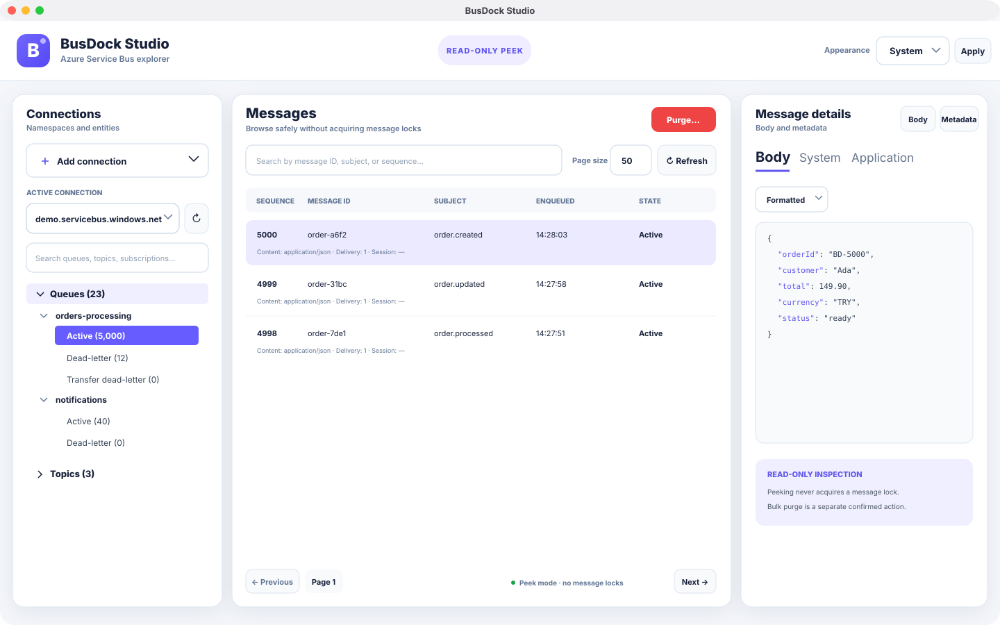

# BusDock Studio

<p align="center">
  <strong>A focused, safety-first desktop explorer for Azure Service Bus.</strong>
</p>

<p align="center">
  <a href="LICENSE"></a>
  
  
  
</p>

BusDock Studio helps developers inspect queues, topics, subscriptions, dead-letter queues, and message metadata without acquiring message locks. It pairs a compact three-panel interface with deliberately cautious bulk-purge workflows for local troubleshooting and test environments.

> [!IMPORTANT]
> BusDock Studio is an independent community project. It is not developed, sponsored, endorsed, or supported by Microsoft.



## Highlights

- **Read-only peek:** browse active, dead-letter, and transfer dead-letter messages without consuming or locking them.
- **Fast entity navigation:** grouped queues and topics, entity search, compact rows, per-subqueue message counts, and preserved expansion state.
- **Rich message inspection:** formatted JSON, plain text, Base64, raw hex, system properties, application properties, and DLQ diagnostics.
- **Safe bulk purge:** right-click a subqueue, review its namespace and approximate count, then explicitly acknowledge permanent deletion.
- **Saved connections:** connection profiles return on launch while credentials stay in macOS Keychain.
- **Native desktop experience:** system, light, and dark appearances in an Avalonia UI built for macOS first.

## Safety model

BusDock Studio treats message deletion as a separate, destructive workflow:

1. Ordinary browsing always uses Service Bus peek operations.
2. Individual deletion of peeked rows is intentionally unavailable.
3. Purge captures one UTC cutoff, so messages enqueued after the operation begins are not targeted.
4. The app rejects partitioned entities and concurrent purge attempts.
5. Purge delegates to Azure's broker-side bulk operation; it never falls back to client-side receive-and-delete.

Locked, deferred, or scheduled messages may remain. Cancellation, timeout, or connectivity loss can leave a partially completed purge, so use a non-production namespace while evaluating the app.

## Install on macOS

The current packaged target is Apple Silicon (`osx-arm64`). Build a self-contained, ad-hoc signed DMG:

```bash
./scripts/package-macos.sh osx-arm64
open artifacts/BusDockStudio-0.1.0-macos-arm64.dmg
```

Drag **BusDock Studio** into **Applications**. A separate .NET installation is not required. Because local builds are not Apple-notarized, macOS may require Control-click → **Open** on first launch.

See [macOS packaging](docs/macos-packaging.md) for versioning, Developer ID signing, and notarization guidance.

## Run from source

Requirements:

- macOS 12 or later
- [.NET 10 SDK](https://dotnet.microsoft.com/download/dotnet/10.0)
- An Azure Service Bus namespace connection string

```bash
git clone https://github.com/emrekarakas/busdock-studio.git
cd busdock-studio
dotnet restore BusDockStudio.sln
dotnet build BusDockStudio.sln --no-restore
dotnet test BusDockStudio.sln --no-build
dotnet run --project src/BusDockStudio.Desktop
```

## Azure permissions

| Capability | Typical requirement |
| --- | --- |
| Discover queues, topics, and subscriptions | Namespace connection string with **Manage** |
| Peek active and dead-letter messages | **Listen** |
| Broker-side purge | Data-plane access accepted by the Service Bus purge operation |

Use the narrowest practical policy and avoid sharing production connection strings. BusDock Studio stores each connection string as a generic-password item in macOS Keychain. Only the profile ID, display name, namespace hostname, and appearance preference are written to the local settings file.

## Architecture

```text
BusDockStudio.Desktop          Avalonia UI and MVVM composition
        │
        ├── BusDockStudio.Core              domain models and safe use cases
        ├── BusDockStudio.AzureServiceBus   Azure SDK adapters
        └── BusDockStudio.Infrastructure    Keychain and local settings
```

The UI and Core projects do not depend on Azure SDK models. This keeps formatting, pagination, purge coordination, and safety checks independently testable. The architectural reasoning is documented in [ADR 0001](docs/adr/0001-architecture.md).

## Current limitations

- The packaged build currently targets Apple Silicon; Intel macOS, Windows, and Linux packages are not published yet.
- Topic messages must be inspected through a subscription.
- Resending dead-letter messages is intentionally outside the current release.
- The Azure SDK purge operation used by the adapter is still a preview surface and is unavailable for partitioned entities.
- Public macOS releases still require Developer ID signing and Apple notarization.

See the [roadmap](docs/roadmap.md) for interactive Azure authentication, DLQ resend safety, additional platform packages, and future product work.

## Contributing and security

Issues and focused pull requests are welcome. Start with [CONTRIBUTING.md](CONTRIBUTING.md) and the [Code of Conduct](CODE_OF_CONDUCT.md).

Never include real connection strings, SAS keys, message bodies, customer namespace names, or screenshots containing sensitive data in an issue. Report vulnerabilities privately according to [SECURITY.md](SECURITY.md).

## License

BusDock Studio is available under the [MIT License](LICENSE).
